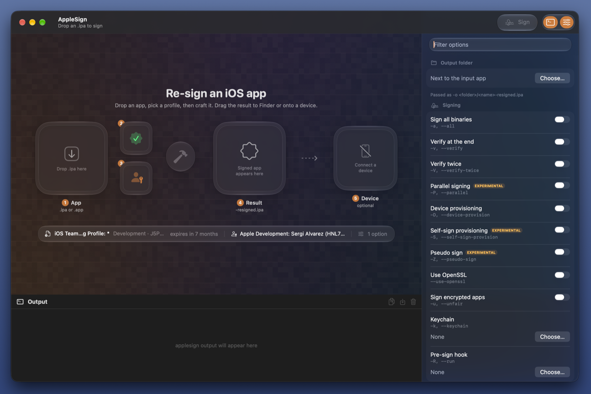

# AppleSign

**Re-sign iOS apps by dragging and dropping them.**



AppleSign is a native macOS app built on
[node-applesign](https://github.com/nowsecure/node-applesign), the iOS
re-signing engine from [NowSecure](https://www.nowsecure.com). Drop an `.ipa`
on the crafting table, add a provisioning profile and a signing identity, and
press the hammer. The signed app is ready to drag into Finder or onto your iPhone.

## Highlights

- **Drag-and-drop signing.** Drop the app, the profile and the identity in
  their slots, then drag the signed `-resigned.ipa` out.
- **Fast for many apps.** It remembers your last profile, picks the matching
  identity, and can sign as soon as you drop an app.
- **Every applesign option.** Strip plugins, change the bundle ID, insert a
  dylib, thin the binaries and more, with the exact command line shown as you
  go.
- **Install on a device.** With [libimobiledevice](https://libimobiledevice.org)
  installed, connected iPhones and iPads show up on the table, ready to install.
- **Live output.** Watch everything applesign does as it runs.
- **Nothing else to install.** applesign comes bundled as a Node 26 single
  executable. Signing uses Apple's `codesign` or a `.p12` identity with
  [ldid](https://github.com/ProcursusTeam/ldid).

## Install

Download the DMG from
[Releases](https://github.com/trufae/mac-applesign/releases) and drag AppleSign
to Applications. It needs macOS 26 or newer on Apple silicon.

For device installs: `brew install ideviceinstaller`

## Build from source

```sh
git clone -b 7.1.0 https://github.com/nowsecure/node-applesign ../node-applesign
make run          # build and launch (also: install, uninstall, dmg)
```

CI clones node-applesign 7.1.0, builds the single executable, the app and the DMG,
and publishes a release for every `v*` tag. Add the `DEVELOPER_ID_*` and
`APPLE_*` secrets to sign and notarize in CI. See
[the workflow](.github/workflows/build.yml).

## License

MIT.
